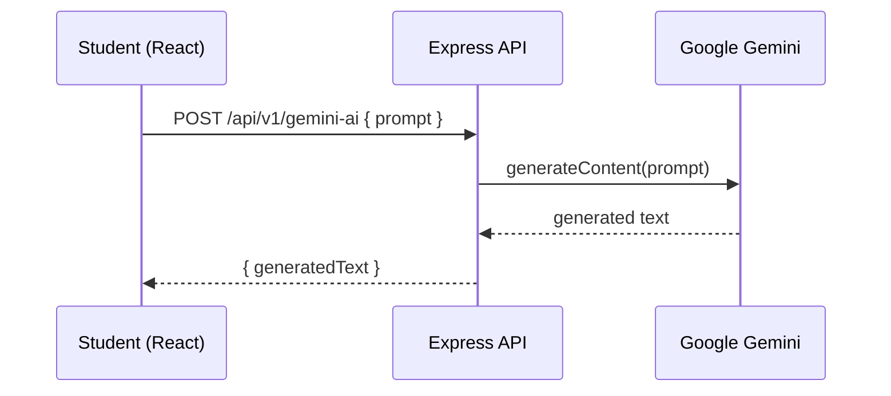
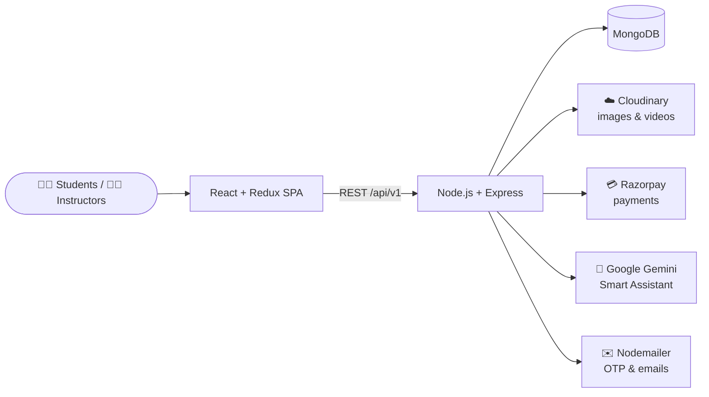

<div align="center">

# 🎓 Techies HUB — With Smart Assistant

**A full-stack MERN EdTech platform where instructors publish courses, students learn and pay securely, and a Gemini-powered AI assistant answers questions on the spot.**

[](https://techies-hub.vercel.app/)


[Introduction](#-introduction) · [Smart Assistant](#-smart-assistant-gemini-ai) · [Architecture](#%EF%B8%8F-system-architecture) · [API](#-api-design) · [Installation](#-installation) · [Important Notes](#%EF%B8%8F-important)

</div>

---

## 📖 Introduction

Techies HUB is a fully functional EdTech platform that enables users to create, consume, and rate educational content. The platform is built using the MERN stack, which includes ReactJS, NodeJS, MongoDB, and ExpressJS.

Techies HUB aims to provide a seamless and interactive learning experience for students, making education more accessible and engaging. Additionally, the platform serves as a platform for instructors to showcase their expertise and connect with learners across the globe.

## 🤖 Smart Assistant (Gemini AI)

The "Smart Assistant" in the name is a built-in **AI chat page** powered by Google Gemini. Learners can ask anything — explain a concept, debug a snippet, summarise a topic — without leaving the platform.



- Frontend: [`src/pages/GeminiAI.jsx`](src/pages/GeminiAI.jsx) — chat UI with message history
- Backend: [`server/routes/Gemini-ai.js`](server/routes/Gemini-ai.js) — uses `@google/generative-ai`
- Requires `GEMINI_API_KEY` in `server/.env`; set `GEMINI_MODEL` to pin a specific model (default: `gemini-flash-latest`)

## 🏛️ System Architecture

<div align="center">
  
</div>
<br/>

The Techies HUB EdTech platform consists of three main components: the front-end, the back-end, and the database. The platform follows a client-server architecture, with the front-end serving as the client and the back-end and database serving as the server.



### Front-end

The front-end of the platform is built using ReactJS, which allows for the creation of dynamic and responsive user interfaces, crucial for providing an engaging learning experience to students. The front-end communicates with the back-end using RESTful API calls.

<details>
<summary><b>📄 Front-end pages</b></summary>

**For Students:**

- **Homepage:** A brief introduction to the platform with links to the course list and user details.
- **Course List:** A list of all the courses available on the platform, along with their descriptions and ratings.
- **Wishlist:** Displays all the courses that a student has added to their wishlist.
- **Cart Checkout:** Allows the user to complete course purchases.
- **Course Content:** Presents the course content for a particular course, including videos and related material.
- **User Details:** Provides details about the student's account, including their name, email, and other relevant information.
- **User Edit Details:** Allows students to edit their account details.
- **Gemini AI Chat:** Ask the Smart Assistant anything while learning.

**For Instructors:**

- **Dashboard:** Offers an overview of the instructor's courses, along with ratings and feedback for each course.
- **Insights:** Provides detailed insights into the instructor's courses, including the number of views, clicks, and other relevant metrics.
- **Course Management Pages:** Enables instructors to create, update, and delete courses, as well as manage course content and pricing.
- **View and Edit Profile Details:** Allows instructors to view and edit their account details.

</details>

**Tools & libraries:** ReactJS, CSS and Tailwind for styling, and Redux for state management.

### Back-end

The back-end of the platform is built using NodeJS and ExpressJS, providing APIs for the front-end to consume. These APIs include functionalities such as user authentication, course creation, and course consumption. The back-end also handles the logic for processing and storing the course content and user data.

<details>
<summary><b>⚙️ Back-end features</b></summary>

- **User Authentication and Authorization:** Students and instructors can sign up and log in to the platform using their email addresses and passwords. The platform also supports OTP (One-Time Password) verification and forgot password functionality for added security.
- **Course Management:** Instructors can create, read, update, and delete courses, as well as manage course content and media. Students can view and rate courses.
- **Payment Integration:** Students will purchase and enroll in courses by completing the checkout flow, followed by Razorpay integration for payment handling.
- **Cloud-based Media Management:** Techies HUB uses Cloudinary, a cloud-based media management service, to store and manage all media content, including images, videos, and documents.
- **Markdown Formatting:** Course content in document format is stored in Markdown format, allowing for easier display and rendering on the front-end.
- **AI Assistant:** A Gemini endpoint that turns a prompt into a generated answer.

</details>

<details>
<summary><b>🧰 Back-end frameworks, libraries and tools</b></summary>

- **Node.js:** Used as the primary framework for the back-end.
- **Express.js:** Used as a web application framework, providing a range of features and tools for building web applications.
- **MongoDB:** Used as the primary database, providing a flexible and scalable data storage solution.
- **JWT (JSON Web Tokens):** Used for authentication and authorization, providing a secure and reliable way to manage user credentials.
- **Bcrypt:** Used for password hashing, adding an extra layer of security to user data.
- **Mongoose:** Used as an Object Data Modeling (ODM) library, providing a way to interact with MongoDB using JavaScript.
- **@google/generative-ai:** Gemini SDK powering the Smart Assistant.

</details>

<details>
<summary><b>🗄️ Data models and database schema</b></summary>

- **Student Schema:** Includes fields such as name, email, password, and course details for each student.
- **Instructor Schema:** Includes fields such as name, email, password, and course details for each instructor.
- **Course Schema:** Includes fields such as course name, description, instructor details, and media content.

</details>

### Database

The database for the platform is built using MongoDB, a NoSQL database that provides a flexible and scalable data storage solution. MongoDB allows for the storage of unstructured and semi-structured data. The database stores the course content, user data, and other relevant information related to the platform.

<div align="center">
  
</div>
<br/>

## 📡 API Design

The Techies HUB platform's API is designed following the REST architectural style. The API is implemented using Node.js and Express.js. It uses JSON for data exchange and follows standard HTTP request methods such as GET, POST, PUT, and DELETE.

| Base route | Responsibility |
|---|---|
| `/api/v1/auth` | Sign up, login, OTP, password reset |
| `/api/v1/profile` | Profile details, enrolled courses, instructor dashboard |
| `/api/v1/course` | Courses, sections, sub-sections, categories, ratings |
| `/api/v1/payment` | Razorpay order capture & verification |
| `/api/v1/contact` | Contact-us form |
| `/api/v1/gemini-ai` | Smart Assistant prompt → answer |

## 🚀 Installation

1. Clone the repository:
   ```bash
   git clone https://github.com/Shariq2003/Techies-HUB-With-Smart-Assistant.git
   cd Techies-HUB-With-Smart-Assistant
   ```
2. Install dependencies in both the root directory and the `server` directory:
   ```bash
   npm install
   cd server && npm install
   ```

### Configuration

Copy the samples and fill in your actual values:

```bash
cp .env.sample .env
cp server/.env.sample server/.env
```

<details>
<summary><b>🔑 Environment variables</b></summary>

**`server/.env`**

| Variable | Used for |
|---|---|
| `PORT` | API port |
| `MONGODB_URL` | MongoDB connection string |
| `JWT_SECRET` | Signing auth tokens |
| `CORS_ORIGIN` | Allowed frontend origin |
| `MAIL_HOST` / `MAIL_USER` / `MAIL_PASS` | Sending OTP & notification emails |
| `CONTACT_MAIL` | Inbox for contact-form messages |
| `CLOUD_NAME` / `API_KEY` / `API_SECRET` | Cloudinary credentials |
| `FOLDER_NAME` / `FOLDER_VIDEO` | Cloudinary upload folders |
| `RAZORPAY_KEY` / `RAZORPAY_SECRET` | Razorpay payments |
| `GEMINI_API_KEY` | Google Gemini (Smart Assistant) |
| `GEMINI_MODEL` *(optional)* | Gemini model to use — defaults to `gemini-flash-latest` |

**Root `.env` (React)**

| Variable | Used for |
|---|---|
| `REACT_APP_BASE_URL` | Backend base URL |
| `REACT_APP_RAZORPAY_KEY_ID` | Razorpay checkout key |

</details>

### Usage

1. Start the UI: `npm start`
2. Open a new terminal and navigate to the `server` directory: `cd server`
3. Start the server: `npm run dev`

Access the application in your browser at `http://localhost:3000`.

## ⚠️ Important

- Backend is in the `server` folder.
- Before uploading courses, create the categories (e.g. Web Dev, Python, etc.) — without categories, courses cannot be added. To create categories, create an Admin account, then go to Dashboard → Admin panel.
- To create an Admin account, first sign up with a student or instructor account, then go to your database under the `users` model and change that `accountType` to `Admin`.
- The project is set up to use `postcss-cli` to process your CSS files. You can customise Tailwind via `tailwind.config.js`.

## 📜 License

Released under the [MIT License](LICENSE).

---

<div align="center">

Built by **[Shariq](https://github.com/Shariq2003)** · [LinkedIn](https://www.linkedin.com/in/shariq-sd)

⭐ If you like this project, consider giving it a star!

</div>
